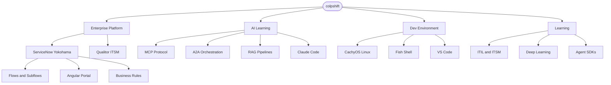

 

 

**[About](#about) · [Stack](#stack) · [Learning](#ai-learning-journey) · [Map](#ecosystem-map) · [Stats](#stats) · [Connect](#connect)**

---

## About

<table>
<tr>
<td width="60%" valign="top">

I build enterprise integrations and automation on **ServiceNow** and **Angular** — flows, subflows, business rules, client scripts, and service portals that people actually rely on.

On the AI side, I'm actively learning **MCP (Model Context Protocol)**, **A2A**, **RAG pipelines**, **Generative AI**, and **Deep Learning** — going beyond prompts to understand how these systems actually work.

My daily stack is **CachyOS Linux + Fish shell + VS Code + Claude Code**. The IDE is a tool; the AI is a force multiplier.

</td>
<td width="40%" valign="top">

**Now**

- Deepening **ServiceNow Yokohama** — UI Builder, Angular Service Portal, advanced Flow Designer patterns
- Building **AI agent integrations** using MCP and A2A on top of real enterprise workflows
- Bridging ITIL/ITSM fundamentals with AI-assisted service management

</td>
</tr>
</table>

> *The goal is always the same: close the gap between what I know and what the problem needs.*

---

## Stack

<table>
<tr>
<td align="center"><b>Languages</b></td>
<td>

</td>
</tr>
<tr>
<td align="center"><b>Platforms and Frameworks</b></td>
<td>

</td>
</tr>
<tr>
<td align="center"><b>AI and Agentic Systems</b></td>
<td>

</td>
</tr>
<tr>
<td align="center"><b>Environment</b></td>
<td>

</td>
</tr>
</table>

---

## AI Learning Journey

Actively learning AI — not just using tools, but understanding what's under the hood.

<table>
<tr>
<td width="33%" valign="top">

**🔌 MCP** 
Model Context Protocol — how AI models connect to live data and external context

</td>
<td width="33%" valign="top">

**🤝 A2A** 
Agent-to-Agent — multi-agent coordination and orchestration patterns

</td>
<td width="33%" valign="top">

**📚 RAG pipelines** 
Retrieval-augmented generation for knowledge-grounded AI responses

</td>
</tr>
<tr>
<td width="33%" valign="top">

**✨ Generative AI** 
Applied concepts: prompting, fine-tuning, evaluation, deployment

</td>
<td width="33%" valign="top">

**🧠 Deep Learning** 
Fundamentals: neural networks, transformers, embeddings

</td>
<td width="33%" valign="top">

**⌨️ Claude Code** 
Daily collaborator, not a search engine — learning by building alongside it

</td>
</tr>
</table>

The goal: apply AI knowledge directly to **ServiceNow and Angular workflows** to understand what's possible and what's not.

---

## Ecosystem Map

<b>Expand the map</b>

---

## Stats

&nbsp;&nbsp;

 

 

---

## Connect

 

